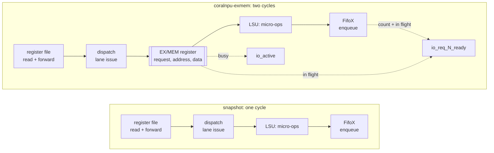

# coralnpu on asap7

[CoralNPU](https://github.com/google-coral/coralnpu) is Google's open
RISC-V core for edge machine learning: an in-order scalar core that
dispatches up to four instructions a cycle, with a float unit, two TCM
SRAMs and AXI ports. `../../src/coralnpu/CoreMiniAxi.sv` is firtool's
output for `CoreMiniAxi`, every file of the build concatenated.

| design | what it builds |
|---|---|
| `coralnpu` | the snapshot as a synthesis build |
| `coralnpu-regfile` | the integer register file generated as an array |
| `coralnpu-exmem` | an EX/MEM register in front of the load/store unit |
| `coralnpu-regfile-exmem` | both |

## Results at global route

OpenROAD's global route with timing repair, built with bazel-orfs.
Each design's clock sits just under what it reaches, so repair has a
target and the WNS is slightly negative.

| design | clock | period at global route | std-cell area | CTS + global route |
|---|---|---|---|---|
| `coralnpu` | 1,900 ps | 2,031 ps | 16,757 µm² | about 8,700 s |
| `coralnpu-regfile` | 1,900 ps | 1,902 ps | 15,628 µm² | 836 s |
| `coralnpu-exmem` | 1,700 ps | 1,701 ps | 16,041 µm² | 1,172 s |
| `coralnpu-regfile-exmem` | 1,650 ps | not yet measured; meets 1,700 ps | 15,565 µm² at 1,700 ps | 642 s at 1,700 ps |

In `coralnpu`, nearly all of the CTS and global route time is
`repair_timing` chasing the one family of paths described below.
With the EX/MEM register, the worst path is the register file into the
CSR's `minstret` counter, a path upstream has also worked on
([8baac41](https://github.com/google-coral/coralnpu/commit/8baac41897c40c6eafdbaabe491117dc60c6175e),
"Fix critical path in CSR minstret register"); the snapshot does not
record whether it predates that change.

## Where the RTL comes from, and what is missing

The snapshot records neither the coralnpu commit it was generated from
nor how. It should: a `MODULE.bazel` here that builds the Verilog from a
pinned coralnpu commit, with the output checked in, so that testing
coralnpu for ORFS and OpenROAD needs neither Bazel nor Chisel, and a
fresh copy is one command. Until then the snapshot stands, and upstream
has moved on from it (below).

`surgery.py` (`SYNTH_VERILOG_SURGERY`) edits the snapshot before
synthesis. Some of it is the gap between what upstream ships and what an
idiomatic ORFS build needs, which upstream is not expected to close:

- firtool's verification layers removed, as a build without layers
  enabled would leave them;
- the two TCM SRAMs moved into memory modules that `AUTO_MEMORIES`
  generates, write masks and all;
- `--regfile`: the integer register file's 31 words moved into a module
  that `AUTO_MEMORIES_REGFILES` generates.

`--address-register` is not that. It is a placeholder for a fresh
snapshot from upstream.

## Surgery: an exercise left to the reader, solved

In the snapshot, one execute cycle reads the register file, forwards an
ALU result through it, lets dispatch decide which lanes issue, and has
the load/store unit build its micro-ops and enqueue them in its input
queue (`FifoX`, eight slots filled in one cycle). On asap7 this one
family of paths sets the period, 2,031 ps at global route.

The classic pipeline puts a register here: the EX/MEM latch of Hennessy
and Patterson's five-stage pipeline, which holds the effective address,
the store data and the request between execute and the memory side
(Rocket and CV32E40P do the same). `surgery.py --address-register` adds
it on `LsuV1`'s inputs:

- `io_req_N_ready` keeps the snapshot's thresholds, applied to the
  queue's count plus the entries the register will enqueue, so a request
  accepted now has its room a cycle later.
- `io_active` includes the register, so a fence waits for it.
- Loads and stores take one cycle longer. Nothing else changes.

bazel-orfs's `test/coralnpu_exmem` simulates both load/store units
under the same random requests, up to four lanes a cycle with the buses
stalling at random, and compares every bus transaction, writeback,
flush and fault in order; a negative control without the ready
adjustment must differ, and does. It also checks that the surgery
changes `LsuV1` and no other module.

### What the silicon did

CoralNPU is in silicon: Synaptics' Astra SL2610 is its first production
implementation, and VeriSilicon, Google's commercial partner for the
IP, has built test silicon. Whoever implemented it met this cycle, in
one of three ways: a register as above, less work per cycle (fewer
lanes, a smaller configuration), or a slower clock. We probably cannot
know which. What is public:

- the SL2610 datasheet rates the NPU at "up to 1 TOPS" and gives no
  clock for the CoralNPU core;
- Google states targets of 1 GHz (22 nm) and VeriSilicon 800 MHz
  (22 nm), not measured silicon;
- upstream coralnpu has reworked this cycle in Chisel since the
  snapshot was taken:
  [43d2030](https://github.com/google-coral/coralnpu/commit/43d20300e9968a444eec4756f42135226e4fbc59)
  "Drive Regfile busPort.data from unforwarded rdata" takes the
  ALU-to-register-file forwarding out of the load/store unit's enqueue
  timing, and a series of LSU timing changes follows, against a stated
  target of 800 MHz in 12 nm
  ([03fa31a](https://github.com/google-coral/coralnpu/commit/03fa31aa589fa4bf8616ffcae54b41d301b57e73)).

### What is not solved here

The proper fix is in the source: a patch to coralnpu's Chisel,
Verilog regenerated from it, and coralnpu's own tests run on the
result, or simply a fresh snapshot of an upstream that has done the
work. That is out of scope for this design. The surgery is an
implementation step on a snapshot, verified by the simulation above
and not by coralnpu's own test suite.
