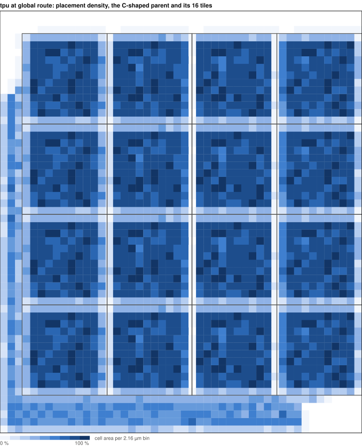
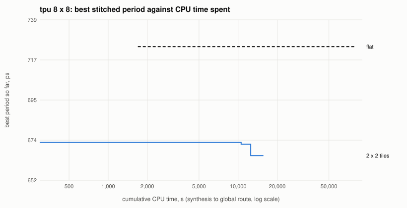
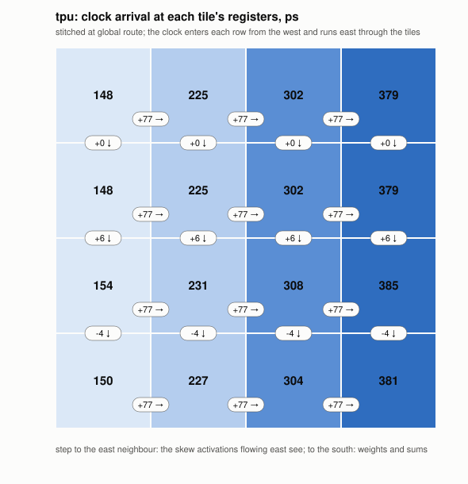

# tpu: abutted tiles, the parent a macro too

A systolic array of 8 x 8 processing elements (`src/tpu`), built as 17
macros and no standard cell at the top:

- **16 identical tiles** (`tpu_block`) of 2 x 2 processing elements,
  carved out of the flat design during synthesis
  (`SYNTH_VERILOG_SURGERY`, `surgery.py` running `flow/util/carve.py`):
  the design's own cells regrouped, the RTL untouched.
- **the parent as a macro** (`tpu_rest`): everything else of tpu, the
  skew and deskew registers, the clock root, the weights in, is one
  C-shaped macro whose notch holds the tiles (`flow/util/wrap_parent.py`,
  `tpu_io.tcl`). Its abstract obstructs only what it occupies
  (`WRITE_ABSTRACT_LEF_ARGS` empty), so the notch stays free.
- **abutment**: every tile meets its neighbours and the parent pin on
  pin. Every pin is placed by rule, from the constants in `tpu_io.tcl`,
  before anything is built, so the tile and the parent build side by
  side; the top level places the macros (`place.tcl`) and is placement
  and wires only.

`make DESIGN_CONFIG=./designs/asap7/tpu/config.mk FLOW_VARIANT=flat`
builds tpu flat from the same RTL, the reference.



Placement density at global route, each tile's own cells drawn in place:
the tiles are 80 % full; the parent's three sides around them hold its
skew and deskew registers sparsely.

## Why

QoR is the best result within a build budget. In a hierarchical flow the
parent places, repairs and routes around its macros' abstracts: it
waits for every macro, and every macro change re-places it. Here the
parent is a macro like the tiles, built against the same pin plan, so
every macro builds side by side and an RTL edit in a tile rebuilds that
tile alone. Measured at global route, with the reg2reg minimum period
stitched across every macro (the study:
https://github.com/The-OpenROAD-Project/bazel-orfs/pull/1396):

| | tiles in a C | flat |
|---|---|---|
| reg2reg minimum period, mean of three placement seeds | 672.6 ps (92 %) | 729.3 ps |
| a fresh build, critical path | 76 s | 436 s |
| an RTL edit in a processing element | 99 s | 487 s |
| die | 1.39 x | 1 x |



The carved design's first sensible floorplan beats everything flat
reaches with five times the CPU; tuning either one moves its period by
less than a placement seed does.


## The rules of the game

tpu is mesochronous with its surroundings: the same clock frequency, a
fixed but unknown phase. Its clock reaches each tile through the tiles
before it, so the phase at its registers is not the clock root's; data
crosses its boundary through FIFOs, which are assumed to be outside tpu.
So only reg2reg paths are judged, and the boundary is a `set_max_delay`
budget for repair, with no input or output delay (`constraint.sdc`,
`flow/platforms/asap7/constraints.sdc`). tpu has every pin on its bottom
edge, as a macro abutting its parent would; inside, each macro has its
pins on the sides its neighbours are on. Every macro routes on M2-M8;
M9 brings power from above.

## How it is clocked

The clock, reset and load enable enter each row of tiles from the
parent at its west end and run east through the tiles with the
activations, one buffer per tile; rows enter together. Each tile sees
the clock about 77 ps after its west neighbour, so data flowing east is
captured later than it is launched, and data flowing south sees no
skew. Only neighbours' skew matters, as Fisher and Kung showed for
pipelined clocks in systolic arrays: no clock tree is balanced across
the array. The bottom row passes its clock down to the deskew registers
in the parent.




## The worst path at the top level

The worst slack at the top level is not reg2reg but in2reg: tpu's
`a_valid` and `a_data` into the top-left tile.

```
  +----+-------------------------------------------+
  |    |  parent, top side                         |
  |    +-------------+-------------+-------- ...   |
  |    | u_b0_0      | u_b0_1      |               |
  |    |  PE(0,0)    |             |               |   row 0
  |  +----> a_in     |             |               |
  |  ^ +-------------+-------------+-------- ...   |
  |  | |            the other 14 tiles             |
  |  | +-------------------------------------------+
  |  | |  parent, bottom side                      |
  +--^-+-------------------------------------------+
     a_valid, a_data[7:0]: tpu's pins, bottom edge

   0.0 ps    pin a_valid
 100.8 ps    u_b0_0/a_in: up the parent's west side, through the mux
             a_valid ? a_data : 0; row 0 has no skew register
 670.8 ps    PE(0,0)'s multiply-add into its partial-sum register
 300.0 ps    the in2reg budget: slack -370.8 ps
```

The RTL delays row i of the activations i cycles so partial sums meet
down each column: row 0 gets none, and the minimum latency with it. The
zeros on idle cycles are injected where the rows enter, and the PE
multiplies its west input as it arrives. So from tpu's inputs to its
first partial sum is one multiply-add, half of a reg2reg path whose
other half is a register outside tpu: no in2reg budget under one
multiply-add holds it, wherever the pins are.

The mesochronous context makes it a reg2reg path. tpu's interface is
valid in (`a_valid`, `w_valid`) and valid out (`c_valid`), with no
back-pressure, and it takes a bubble anywhere. A FIFO at tpu's level,
on tpu's one clock, its pin side on a short branch of the clock tree
and its logic side on the macros' deep one, turns the path into FIFO
register to partial sum, judged with the period; the pins see only the
short branch.

## Files

| file | what |
|---|---|
| `config.mk` | tpu: the top level of macros (base), or flat (`FLOW_VARIANT=flat`) |
| `tpu_block/config.mk` | the tile, with the settings a placement and clock-tree search found best |
| `tpu_rest/config.mk` | the parent macro |
| `surgery.py` | the carve and the parent's module, during synthesis |
| `tpu_io.tcl` | the pins of the tile and of the parent, and the parent's notch |
| `place.tcl`, `io_top.tcl`, `pdn_top.tcl`, `tapcell_none.tcl`, `dpl_none.tcl` | the top level of macros only |
| `pdn_macro.tcl` | every macro's power: rails, M5 straps, M8 straps the top level's M9 lands on |
| `pins_bottom.tcl` | flat's pins, all on its bottom edge |
| `*.svg` | the figures above, from the study |

## Limits

- **Hold fails across macros.** Timed with every macro's own cells and
  wires, 143 endpoints from a tile into the parent fail hold, worst
  -417.4 ps, and 75 inside the parent, worst -130.0 ps. The parent's
  deskew registers take their clock from the bottom row of tiles through
  the parent's own tree, about 250 ps after the tile registers that feed
  them, and the parent mixes those clocks with its own; no flow repairs
  hold across macros, each sees only its side. The clock taken out of
  the macros and balanced at a top level of its own closes hold, at a
  13 % longer period so far: the chain's skew was free time for every
  path flowing east (the study has the numbers). The periods above are
  setup only; with the clock paths derated 5 % either way and common path
  pessimism removed, the carved period is 668.3 ps.

- **Area**: 1.39 x flat's die. The tiles are 80 % full; the parent's
  three sides around them hold its 676 um2 of registers at 5.6 %.
- **The parent's repair does not see inside the tiles**: it times their
  pins as ports with budgets. tpu's worst path starts and ends inside one
  tile, so this costs nothing here.
- **Power at the top level reaches the parent only**: pdngen takes the
  parent's whole outline as occupied and draws nothing over the tiles.
